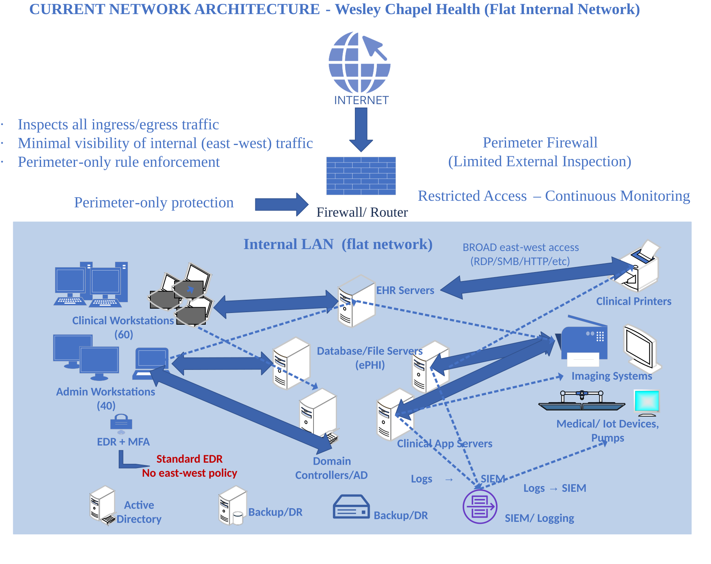
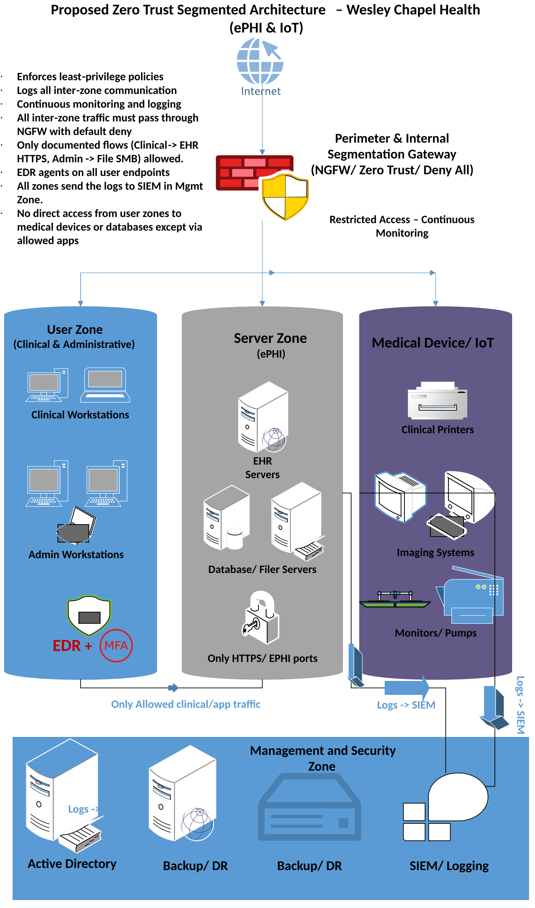

# Zero Trust Network Segmentation with EDR

**Academic cybersecurity capstone | Western Governors University | Arley Alexandre**

> **Project scope:** A conceptual security architecture and evaluation for a modeled mid-sized healthcare provider. This is not a production implementation, security audit, or independently verified test result.

## Executive summary

This capstone develops a Zero Trust-inspired internal network segmentation and endpoint detection and response (EDR) strategy to reduce lateral-movement risk and protect electronic protected health information (ePHI). The modeled environment includes approximately **100 Windows endpoints** and **10 critical servers**, including electronic health record (EHR), file, and clinical systems.

**Skills demonstrated:** Cybersecurity risk analysis · Zero Trust architecture · Network segmentation · EDR · SIEM use cases · Incident response planning · NIST control mapping · HIPAA security considerations · Stakeholder communication · Security governance

**[View the 4-page project case study (PDF)](Zero_Trust_Healthcare_Capstone_Case_Study.pdf)**

## Business problem

A largely flat internal network can permit a compromised workstation or vendor identity to reach sensitive systems. Limited endpoint telemetry and broad east-west connectivity increase the potential impact of ransomware, unauthorized access, and disruption to clinical services.

## Proposed solution

- **Network segmentation:** Separate clinical workstations, administrative users, ePHI servers, medical devices, and management systems; enforce approved interzone flows using a next-generation firewall.
- **Endpoint visibility:** Establish EDR coverage, configuration baselines, process and authentication telemetry, agent health checks, and behavioral alerting.
- **Security monitoring:** Correlate firewall, endpoint, server, and application events in a centralized SIEM.
- **Incident response:** Document triage, escalation, containment, access revocation, recovery, and lessons-learned procedures.
- **Governance:** Define policies, responsibilities, risk treatment, rollout phases, training, and KPIs.

## Architecture diagrams

The diagrams below are from the original academic capstone. Select either diagram to view the full-resolution image.

### 1. Current-state network: flat internal architecture

The modeled baseline illustrates broad internal connectivity between user endpoints, clinical applications, ePHI servers, and medical devices. This is the risk the proposed segmentation seeks to address.

### 2. Proposed Zero Trust segmentation architecture

The target design separates user, ePHI server, medical-device, and management/security zones, with controlled interzone traffic, EDR, and centralized security logging. **Both diagrams depict a conceptual design, not a production deployment.**

## Frameworks and regulatory context

- **NIST SP 800-207:** Zero Trust architectural principles.
- **NIST SP 800-53:** Control-oriented access and monitoring considerations.
- **HIPAA Security Rule:** Risk management, access controls, audit controls, and ePHI safeguards.

These are **analytical alignments**, not proof of regulatory compliance.

## Proposed validation scenarios

1. A compromised workstation attempts unauthorized access to protected ePHI servers.
2. A vendor account attempts to access resources outside its approved scope.
3. Ransomware-like endpoint activity triggers behavioral detection and response workflows.

**Evaluation status:** The written capstone defines conceptual/tabletop tests and acceptance criteria. It does not report verified production results or quantified before/after risk reductions.

## Planned KPIs

- Percentage of ePHI systems placed in protected zones.
- Change in internal services reachable from ordinary workstations.
- EDR deployment, update, and agent-health coverage.
- Timeliness and quality of high-severity alert triage and escalation.

## Deliverables

- [Recruiter-friendly PDF case study](Zero_Trust_Healthcare_Capstone_Case_Study.pdf)
- Segmentation and EDR architecture concept.
- Security policies and response procedures.
- Phased 16-week rollout and stakeholder plan.
- Evaluation scenarios and performance metrics.

## Source and disclosure

Summarized from two original graduate submissions: *Cybersecurity Graduate Capstone Project Proposal* and *Cybersecurity Graduate Capstone Project Task 3*. The organization is treated here as a modeled academic scenario. The original documents are not published in full because they contain personal academic identifiers and material better suited to a concise portfolio case study.

**Author:** Arley Alexandre
